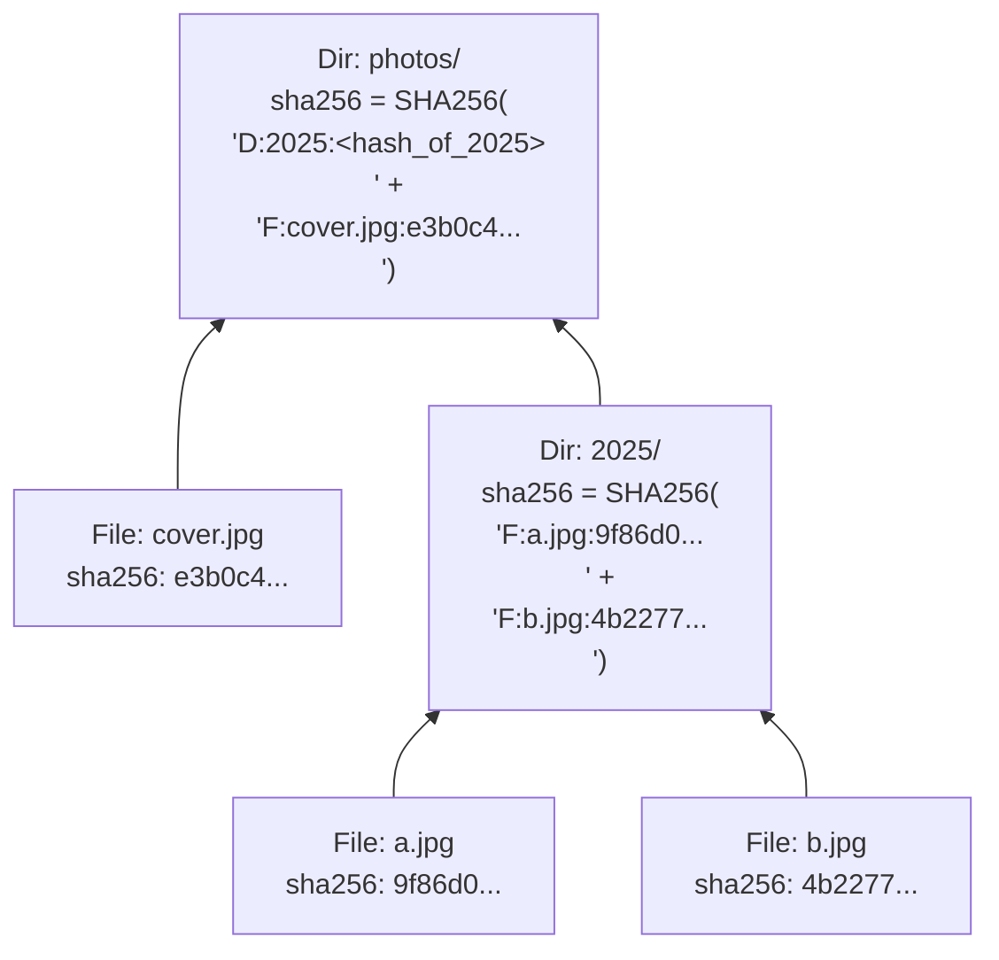

# Notes & Explanations on `plan1.md`

This document explains selected architectural and database design choices from [plan1.md](file:///home/yur/agy-projects/listremo/spec/plan1.md).

---

## 1. SQLite Pragmas ([Section 4: Pragmas](file:///home/yur/agy-projects/listremo/spec/plan1.md#L61-L67))

`PRAGMA` statements are SQLite-specific commands used to configure runtime behavior and storage engine properties on a database connection.

```sql
PRAGMA foreign_keys = ON;
PRAGMA journal_mode = WAL;
PRAGMA synchronous = NORMAL;
```

### `PRAGMA foreign_keys = ON;`
- **What it means**: Enables enforcement of foreign key constraints (`REFERENCES ...`) for the current database connection.
- **Why it is needed**: For historical compatibility reasons, SQLite disables foreign key enforcement by default on every new connection—even if the schema declares `REFERENCES`. In `listremo`, the `entries` table defines:
  ```sql
  root_id INTEGER NOT NULL REFERENCES roots(id) ON DELETE CASCADE
  ```
  With `foreign_keys = ON`, deleting a storage root from `roots` (via `listremo root remove <name>`) automatically cascades and deletes all cataloged files and directories belonging to that root, and prevents inserting orphan entries with a non-existent `root_id`.

### `PRAGMA journal_mode = WAL;`
- **What it means**: Switches SQLite's rollback/crash-recovery mechanism from the traditional rollback journal (`DELETE` mode) to **Write-Ahead Logging (WAL)**.
- **How it works**: Instead of overwriting original database pages directly and keeping old copies in a rollback journal, SQLite appends new changes sequentially to a separate `-wal` file (`listremo.db-wal`) and periodically checkpoints them back into the main database file.
- **Why it is needed**:
  1. **Faster writes during `sync`**: Sequential appends to the WAL file are significantly faster than random-access writes to both the rollback journal and database file.
  2. **Concurrency**: Readers (`listremo list`, `duplicates`, `unique`) do not block writers (`listremo sync`), and writers do not block readers.

### `PRAGMA synchronous = NORMAL;`
- **What it means**: Controls how aggressively SQLite instructs the operating system (`fsync`) to flush data to physical disk platters/flash cells before continuing.
- **How it interacts with `WAL`**:
  - In `FULL` mode (the default), SQLite issues an `fsync` after every single transaction commit to the WAL file.
  - In `NORMAL` mode with `WAL`, SQLite only issues `fsync` during checkpoints (when merging the WAL back into the main database), rather than on every commit.
- **Why it is needed**: According to official SQLite documentation, `journal_mode = WAL` combined with `synchronous = NORMAL` is the recommended high-performance configuration. It remains **corruption-safe** across application crashes and power loss (at worst, a sudden OS crash/power cut immediately after a commit could roll back the very last transaction, without ever corrupting the database structure).

---

## 2. Why Both `rel_path` and `parent_path` Are Needed ([Section 4: Tables](file:///home/yur/agy-projects/listremo/spec/plan1.md#L80-L91))

In the `entries` table:
```sql
rel_path    TEXT NOT NULL,  -- Path relative to root (e.g. "photos/2025/img.jpg", "." for root itself)
parent_path TEXT,           -- Relative path of parent directory (NULL for ".")
name        TEXT NOT NULL,  -- Base filename or directory name ("img.jpg")
```

At first glance, `parent_path` and `name` look redundant because `rel_path` is simply `parent_path ~ "/" ~ name` (e.g., `"photos/2025"` + `"/"` + `"img.jpg"` = `"photos/2025/img.jpg"`). However, storing both `rel_path` and `parent_path` serves two distinct access patterns that SQL alone cannot do efficiently with a single column:

### What `rel_path` is used for:
1. **Unique Identity & Fast Point Lookup (`UNIQUE(root_id, rel_path)`)**:
   - During incremental `sync` ([Section 5.1](file:///home/yur/agy-projects/listremo/spec/plan1.md#L109-L112)), the scanner walks the filesystem and needs an $O(1)$ lookup by exact path (`"photos/2025/img.jpg"`) to check whether the file's `size` and `mtime` changed.
2. **Recursive Subtree Queries ([Section 6.3](file:///home/yur/agy-projects/listremo/spec/plan1.md#L189-L196))**:
   - When querying a subtree at arbitrary depth (e.g., `listremo list backup:/photos`), SQL can filter all descendants at any depth (children, grandchildren, etc.) with a simple prefix match:
     ```sql
     WHERE rel_path = 'photos' OR rel_path LIKE 'photos/%'
     ```
   - Without `rel_path`, fetching an entire subtree would require an expensive recursive Common Table Expression (`WITH RECURSIVE ...`).
3. **Display Formatting**:
   - Directly produces `<root_name>:/<rel_path>` for CLI and CSV outputs without reconstructing paths up the directory hierarchy.

### What `parent_path` is used for:
1. **Direct Children Lookup (1-Level Hierarchy)**:
   - A `LIKE 'photos/%'` query on `rel_path` matches **all** descendants (`photos/a.jpg`, `photos/2025/b.jpg`, `photos/2025/01/c.jpg`), because SQL's `%` wildcard matches across `/` path separators.
   - Finding only the **immediate children** of `"photos"` using `rel_path` alone requires awkward string manipulation in SQL (`WHERE rel_path LIKE 'photos/%' AND rel_path NOT LIKE 'photos/%/%'`).
   - With `parent_path`, finding immediate children of any directory is an exact equality match:
     ```sql
     WHERE root_id = :root_id AND parent_path = 'photos'
     ```
2. **Bottom-Up Directory Hashing & Tree Rendering**:
   - Computing a directory's Merkle hash and recursive size ([Section 5.2](file:///home/yur/agy-projects/listremo/spec/plan1.md#L114-L127))—or rendering a console directory tree—requires grouping entries by their immediate parent directory (`parent_path`) and sorting by `name`.

| Example Entry | `rel_path` | `parent_path` | `name` |
| :--- | :--- | :--- | :--- |
| Root directory itself | `"."` | `NULL` | `"."` |
| Top-level directory | `"photos"` | `"."` | `"photos"` |
| Nested directory | `"photos/2025"` | `"photos"` | `"2025"` |
| File inside nested dir | `"photos/2025/img.jpg"` | `"photos/2025"` | `"img.jpg"` |

---

## 3. Merkle Tree for Directory Hashing ([Section 1: Overview](file:///home/yur/agy-projects/listremo/spec/plan1.md#L10) & [Section 5.2](file:///home/yur/agy-projects/listremo/spec/plan1.md#L114-L127))

### What is a Merkle Tree?
A **Merkle tree** (or **hash tree**), invented by Ralph Merkle in 1979 and widely used in systems like **Git**, **ZFS/Btrfs**, **IPFS**, and **BitTorrent**, is a tree data structure in which:
- Every **leaf node** (a regular file) is labeled with the cryptographic hash of its data.
- Every **interior node** (a directory) is labeled with the cryptographic hash of the labels (names, types, and hashes) of its immediate child nodes.

### How `listremo` Builds the Merkle Tree (Bottom-Up)
Consider a directory `photos/` containing a file `cover.jpg` and a subdirectory `2025/` with two files:



1. **Leaves first (Files)**:
   - Regular files are hashed from their byte contents (or assigned `"0"` if empty).
2. **Bottom-up propagation (Post-order traversal)**:
   - Deepest directories (like `photos/2025`) are hashed first by sorting their immediate children by `name` and hashing the list of `"<type>:<name>:<child_sha256>\n"` lines.
   - Empty directories (with no files and no subdirectories) are assigned `"0"`.
   - Parent directories (like `photos`) then include `D:2025:<sha256_of_2025>` when computing their own hash, propagating all the way up to the root `"."`.

### Why Use a Merkle Tree in `listremo`?
1. **$O(1)$ Whole-Directory Duplicate & Integrity Comparison**:
   - If two directories on different backup drives (`backup_hdd_1:/photos/2025` and `nas_archive:/old_backups/2025`) have the exact same `sha256`, it is cryptographically guaranteed that their **entire directory trees**—every nested file's content, every filename, and every subdirectory structure—are 100% identical.
   - This allows `listremo duplicates --type dir` and `listremo unique --type dir` to find duplicate or unique directory trees across drives using the exact same indexed `sha256` column used for files.
2. **Avalanche Change Detection**:
   - Modifying a single byte in a deeply nested file, renaming a file, or adding/removing a file changes that file's entry, which changes its parent directory's hash, which bubbles all the way up to the root directory `"."`.
3. **Efficient Computation**:
   - Each directory only hashes a short text manifest of its **immediate** children (rather than re-reading or concatenating every descendant file in the subtree), keeping directory hashing fast regardless of how deep or large the subtree is.
